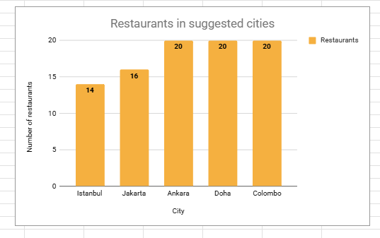

# Restaurant Market Expansion Screener

A spreadsheet-based analysis of Zomato restaurant listings that screens countries for deeper expansion research. The project compares listed restaurants, ratings, votes, cuisines, price ranges, cost for two, and selected service features. It narrows the research scope; it does not estimate market size, demand, or profitability.

**Project:** [View the published Google Sheets dashboard](https://docs.google.com/spreadsheets/d/e/2PACX-1vShjJaXHpAKQRjvNrDSSHYnelcwcL-ZKPluwVdYW0JfbqYQH-B-7fVR6jaYQyk-4VJPid_xZ3k2KAiV/pubhtml) · [Download the Excel workbook](data/Zomato_Restaurant_Expansion_Kunal_Prasad_WorkBook_Project.xlsx)

**Product requirements:** [PRD v1.2 (PDF)](docs/Restaurant_Market_Expansion_Screener_PRD_v1.2_Kunal_Prasad.pdf) · [Editable PRD v1.2 (DOCX)](docs/Restaurant_Market_Expansion_Screener_PRD_v1.2_Kunal_Prasad.docx) · [Archived PRD v1.0 (PDF)](docs/Restaurant_Market_Expansion_Screener_PRD_Kunal_Prasad.pdf)

## Project overview

The analysis asks: **Which markets merit further research for a restaurant brand expanding beyond India?** It uses a historical restaurant-listing dataset to compare countries and selected cities. Restaurant counts and platform ratings are screening signals only; they do not establish competition, customer demand, or investment potential.

The project includes a preserved raw-data sheet, a separate cleaned-data sheet, country/city/cuisine analysis, Pivot Tables, formulas, charts, and a Google Sheets dashboard. The workbook was built in Excel and Google Sheets; there is no application build or package installation.

## Dataset and record reconciliation

- **Raw dataset:** 9,551 restaurant records across 15 countries.
- **Cleaned analysis dataset:** 9,542 records. RestaurantID is unique in both sheets; no rows were removed as duplicates.
- **Nine-record difference:** the nine raw records missing from Cleaned Data all have country code 216 (United States) and a blank Cuisines value. They are the only nine raw records with blank cuisines. The cleaning log records their exclusion as an analyst decision because cuisine analysis requires a cuisine value. Keeping them with an “Unknown” cuisine would be an alternative treatment.
- **India:** 8,652 records, or 90.7% of the cleaned dataset, so the other country samples are much smaller.
- **Rating treatment:** source ratings of 1.0 are treated as “Not rated.” The cleaned data has 7,394 rated records and 2,148 not rated; the raw data has 7,403 rated records and the same 2,148 not rated.

## Cleaning and analysis methods

The workbook keeps Raw Data separate from Cleaned Data. Documented preparation includes:

1. Treat source rating 1.0 as a placeholder by leaving Rating_Clean blank and assigning a rating status. This is an analysis assumption, not a verified property of the source.
2. Blank zero longitude, latitude, and cost values where zero is treated as missing.
3. Map country codes to country names with an exact-match VLOOKUP.
4. Trim inconsistent spacing and apply text and currency-label corrections recorded in the cleaning log. PRD v1.2 notes these corrections were not rechecked cell by cell.
5. Derive Opening_Date, Opening_Year, Primary_Cuisine, and Rated_4plus.
6. Convert cost-for-two values to INR using fixed rates embedded in formulas.

Pivot Tables summarize country, year, city, rating, cuisine, price range, and service features. Spreadsheet functions used in the workbook include IF, IFERROR, VLOOKUP, MID, FIND, TEXT, TRIM, SPLIT, INDEX, DATE, YEAR, REGEXEXTRACT, VALUE, COUNTIFS, AVERAGEIFS, MINIFS, MAXIFS, FILTER, CORREL, QUERY, and SUMPRODUCT.

## Verified findings

The figures below use the cleaned dataset and match the recalculation documented in PRD v1.2. “Rated 4+” is the share among rated records.

| Country in the analysis shortlist | Records | Average rating | Rated 4+ |
|---|---:|---:|---:|
| Indonesia | 21 | 4.30 | 81.0% |
| Turkey | 34 | 4.30 | 88.2% |
| Qatar | 20 | 4.06 | 55.0% |
| Sri Lanka | 20 | 3.87 | 65.0% |

The city screen covers Istanbul (14 records), Jakarta (16), Ankara (20), Doha (20), and Colombo (20). In a four-country comparison, the workbook reports a price-range/rating correlation of about 0.02 over 87 records with the required values. This describes a small sample and does not show that price has no general relationship with ratings. The workbook also reports no online-delivery listings and one table-booking listing in a 95-record four-country group; incomplete feature data may explain that result.

These results support a **research shortlist**, not a recommendation to enter any market. The samples outside India are small, and votes represent recorded platform engagement rather than total restaurant demand or market share.

## Dashboard and screenshot

The workbook’s Dashboard sheet contains six KPI cards, nine charts, and Year and Country slicers. PRD v1.2 confirms that the charts reference Pivot Table ranges. The published link returned HTTP 200 and contained the Dashboard page when checked on 1 November 2026. The exported workbook does not preserve slicer-to-pivot connections, so whether the slicers update every KPI and chart has not been confirmed. There is no Price Range slicer.

The city-count chart below is an existing workbook image and its counts match the cleaned-data city screen.

*Static chart; it is not an interactive dashboard. The separate dashboard screenshot in assets shows older record totals and is not presented here as the current dashboard state.*

## Open the project

No code setup or dependency installation is required.

1. Clone or download this repository.
2. Open data/Zomato_Restaurant_Expansion_Kunal_Prasad_WorkBook_Project.xlsx in Excel to inspect the raw data, cleaning, summaries, and workbook charts.
3. Use the published Google Sheets link above for the browser-based dashboard view.

The .xlsx file is an export of the Google Sheet. Some Google Sheets formulas appear as DUMMYFUNCTION wrappers in the export, and slicer behavior may not carry over to Excel. Use the published view for the dashboard; do not assume every formula or filter will recalculate in the downloaded workbook.

## Repository contents

- assets/ — workbook charts and dashboard images
- data/ — Excel workbook with raw data, cleaned data, analysis, and dashboard
- docs/ — PRD v1.0, PRD v1.2 (PDF and editable DOCX), and analysis solution
- presentations/ — summary presentation
- README.md — project overview, methods, findings, and limitations

The solution document is an analysis write-up, not a PRD: [open the solution document](docs/Zomato_Restaurant_Expansion_Kunal_Prasad_Solution_Project.docx).

## Known limitations and remaining work

- Dashboard headings, methodology notes, key insights, and the saved dashboard screenshot still show pre-cleaning totals (9,551 records and 7,403 rated) instead of 9,542 and 7,394.
- Year and Country slicer connections to all charts and KPI cards need confirmation in the live Google Sheet. A Price Range slicer is not implemented.
- INR exchange rates have no recorded source or date, and the Turkish conversion still needs verification. Treat cross-country cost comparisons as provisional.
- Suggested_Flag does not match the final four-country shortlist. The PRD also records unused dashboard helper formulas, stray formulas on Q-4 I Subjective, and truncated country labels.
- The solution write-up still contains conflicting 9,551/9,542 language; PRD v1.2 identifies it for alignment.
- The repository does not document the dataset’s original download URL or redistribution license. Check reuse rights before republishing the raw data.

## Project Documentation

The current PRD v1.2 PDF and editable DOCX are linked near the top. The archived PRD v1.0 PDF remains in docs/. The [solution write-up](docs/Zomato_Restaurant_Expansion_Kunal_Prasad_Solution_Project.docx) is the analysis document, not a PRD.

## Author

Kunal Prasad · B.Tech Information Technology, 2026 · [LinkedIn](https://www.linkedin.com/in/kunalprasad-dev/) · [Portfolio](https://kunal-portfolio-vite.vercel.app/)
