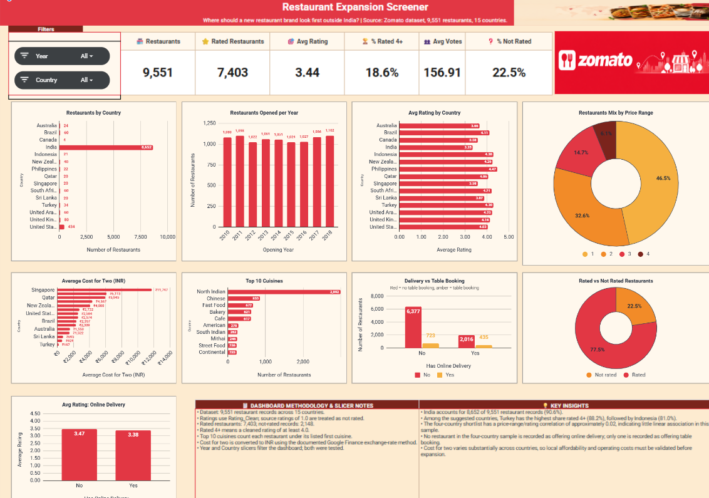

# Restaurant Expansion Screener

**Where should a new restaurant brand look first outside India?**

A market-screening analysis of 9,551 Zomato restaurant records across 15 countries, built with Excel and Google Sheets for the Newton School Data Analytics programme.

**Live workbook and dashboard (Google Sheets, view only):**
https://docs.google.com/spreadsheets/d/1FFTPZCDEp8uPwrw6krGPH1SCO6BpXzb7lsXnuWhZx0g/edit?usp=sharing

> The Excel file in `data/` is a download from Google Sheets. Slicers and some charts do not work in Excel, so please use the live link above.



## Objective

Narrow the research scope by comparing countries and cities on restaurant listings, customer votes, ratings, cost for two and price tier. This is a screening tool, not a final investment decision.

## Repository structure

```
restaurant-expansion-screener/
├── data/            Excel workbook (download of the Google Sheet)
├── docs/            Product Requirements Document (Word and PDF)
├── presentations/   Analysis and recommendations deck (PowerPoint)
├── assets/          Dashboard screenshot and chart images
└── README.md
```

| Folder | File | What it is |
|---|---|---|
| `data/` | 'Zomato_Restaurant_Expansion_Kunal_Prasad_WorkBook_Project' | Workbook with raw data, cleaned data, pivots and dashboard |
| `docs/` | 'Zomato_Restaurant_Expansion_Kunal_Prasad_Solution_Project' | PRD for the proposed next version |
| `presentations/` |'Zomato_Restaurant_Expansion_Screener_Improved' | Presentation of the analysis and recommendations |
| `assets/` | `dashboard-screenshot.png` and chart images | Visuals used in this README and the deck |

## Dataset

- 9,551 restaurant records, 15 countries
- India accounts for 8,652 records (about 90.6%), so other countries have much smaller samples
- 7,403 rated restaurants and 2,148 not rated (a rating of 1.0 was treated as not rated)

## Method

1. **Clean:** blanks for invalid zero values, a Rating_Clean column, corrected labels (TRIM, IF, find and replace)
2. **Enrich:** country name from country code, opening year, currency symbol, cost converted to INR (VLOOKUP, MID, FIND, YEAR)
3. **Summarise:** counts and averages by country, city and cuisine (pivot tables, COUNTIFS, AVERAGEIFS)
4. **Test:** ratings against price tier, delivery, booking and cuisine (CORREL, FILTER)
5. **Visualise:** dashboard with Year and Country slicers

The raw data was preserved, and all transformations were applied to a separate analysis copy.

## Key findings

- **Shortlist for deeper research:** Indonesia, Turkey, Qatar and Sri Lanka
- **Share of rated restaurants scoring 4+:** Turkey 88.2%, Indonesia 81.0%, Sri Lanka 65.0%, Qatar 55.0%
- **City averages (small samples of 14 to 20 listings each):** Jakarta 4.36, Ankara 4.31, Istanbul 4.29, Doha 4.06, Colombo 3.87
- **Cuisines in the shortlist:** Indonesian 4.51 (n=7), Kebab 4.38 (n=10), Turkish Pizza 4.33 (n=8)
- **Price vs rating:** ratings are broadly flat across price ranges 2 to 4, with a pooled correlation of about 0.02 in the shortlist

## Limitations

- The dataset has no revenue, footfall, rent or operating-cost data, so it cannot show demand or profitability.
- Votes show recorded engagement, not market share.
- Samples outside India are small, so differences between countries and cities should be read cautiously.
- Cuisine results are associations in small samples, not proof that cuisine drives ratings.
- Cost for two was converted to INR for comparison. Exchange-rate assumptions matter, and the Turkish conversion values are still to be verified.

## About the PRD

The PRD in `docs/` defines metric definitions, data-quality checks, acceptance criteria and a proposed scoring model for a next version. Items in the PRD are proposed enhancements and are not claimed as built.

## Tools

Excel, Google Sheets, pivot tables, formulas, charts and slicers

## Author

Kunal Prasad
B.Tech Information Technology, 2026
[LinkedIn](https://www.linkedin.com/in/kunalprasaddev) | [Portfolio](https://kunal-portfolio-vite.vercel.app/)